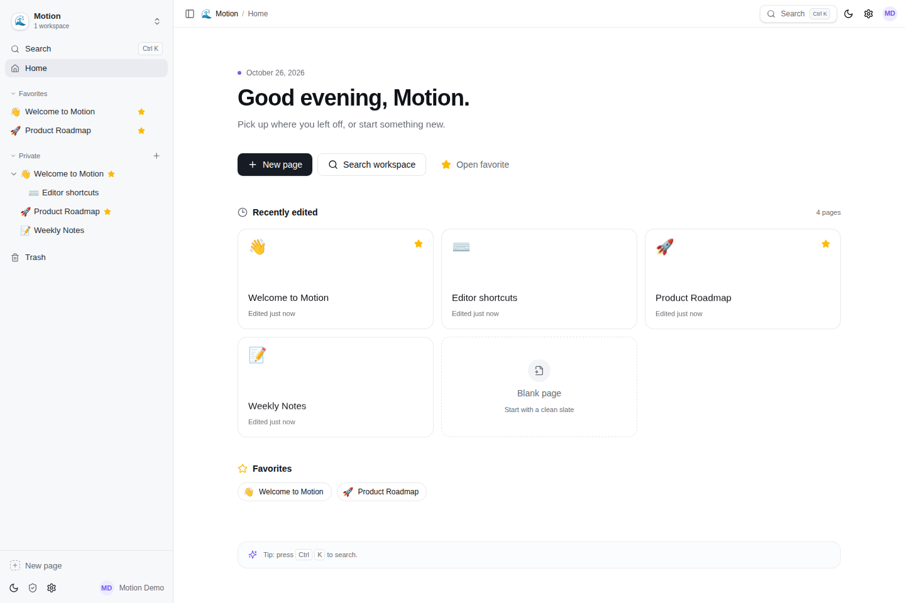
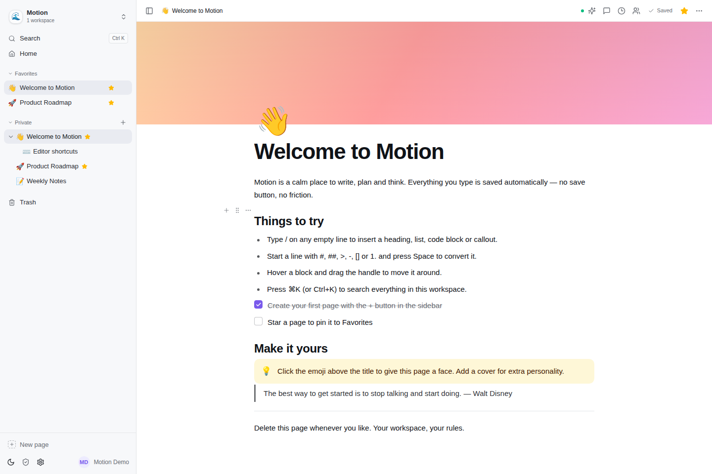
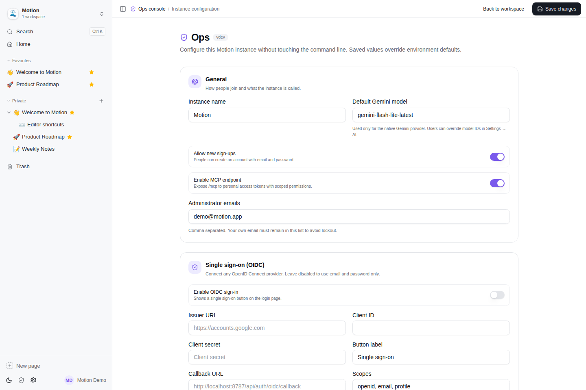
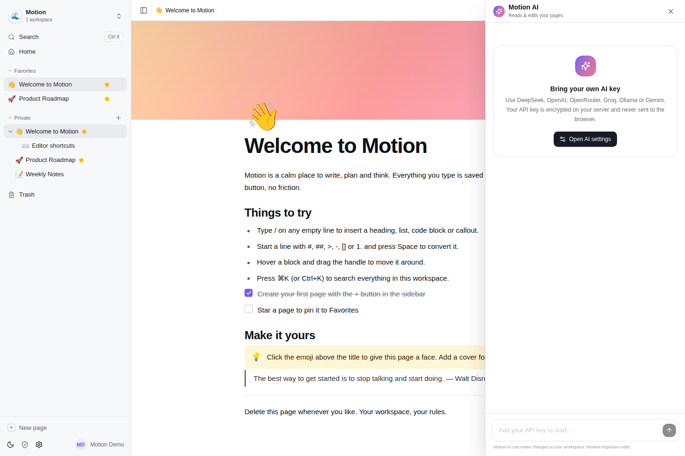

# Motion

一个安静、快速、可自托管的 Notion 风格工作区。前端 React + TailwindCSS + shadcn/ui，后端 Go + MongoDB，生产环境可编译为单个二进制文件（前端已内嵌）。



## 功能

- **块编辑器**：标题、列表、待办、引用、Callout、**可折叠 Toggle/Toggle 标题**、**代码高亮**、分割线、图片、**表格**、**Mermaid 流程图**、**甘特图**、**柱状/折线/饼图**、书签卡片、视频/网页嵌入、文件、LaTeX 公式、目录、**页面链接/面包屑/反向链接**、**分栏**，以及**客户端加密的密码区域**。
- **Lexical 富文本**：加粗、斜体、下划线、删除线、行内代码、链接、撤销/重做、Markdown 行内快捷输入和浮动格式工具栏。
- **密码区域**：密码在浏览器内通过 PBKDF2 + AES-GCM 加密，服务端只保存密文；刷新或 10 分钟后自动重新上锁。
- **附件上传**：图片/文件上传到 GridFS，支持图片拖拽、粘贴和块内上传；代码块支持自动检测/手动语言、语法高亮、行内编辑与复制。
- **@成员提及**：在正文中输入 `@` 搜索工作区成员，提及会随 Lexical 富文本保存。
- **防误操作锁定**：页面级锁定会暂停所有编辑并在侧边栏显示锁图标；单个区块也可独立锁定/解锁。
- **增量同步 + 虚拟列表**：只同步变更块与顺序，WebSocket 不再广播整页；超过 80 块自动虚拟化。
- **Markdown 快捷输入** 与 `/` 斜杠菜单，块拖拽排序，自动保存。
- **Viewer 只读模式**：无编辑权限时真正的只读界面，不显示编辑控件，不会出现“输入后才报 403”。
- **多人实时协作**：工作区成员共享页面，基于 WebSocket 的在线状态、正在编辑的块、实时内容同步和块级三方合并。
- **划词评论 / 块评论 / 回复 / 解决**，评论锚点使用 CSS Custom Highlight 持久高亮，失焦后也不会丢失。
- **文档历史**：自动快照 + 手动保存版本，可预览和恢复，恢复本身也可撤销。
- **BYOK AI 文档助手**：支持 DeepSeek、OpenAI、OpenRouter、Groq、Ollama、Gemini 以及任意 OpenAI 兼容服务。默认 DeepSeek。支持 SSE 流式输出、停止生成、重新生成，并在每次运行前自动保存版本，一键撤销 AI 修改。
- **Google ADK**：AI 助手基于 `google.golang.org/adk`，通过工具读取、搜索、创建和编辑文档。
- **Workspace Skills & MCP**：工作区所有者可以配置可复用 Skills 和远程 Streamable HTTP MCP Server，工作区内所有 AI Agent 自动获得这些能力。
- **Webhook 集成**：工作区可配置带 HMAC 签名的 outgoing webhook，支持评论、AI 审批、发布事件与投递日志。
- **静态发布**：页面可渲染为静态 HTML，通过 SSH/SFTP、GitHub/GitLab/Gitea Pages 或 Jira/Confluence ADF 发布。
- **存储后端**：工作区可选择 GridFS、S3/MinIO/R2、阿里云 OSS、七牛 Kodo 或腾讯云 COS 保存上传文件并发布静态页面。
- **MCP 服务器**：`/mcp` 暴露搜索、读写页面、追加块、更新块、批量删除页面、评论等工具，使用带 Scope 的 PAT 授权。
- **OIDC 单点登录**：Google、Keycloak、Auth0、Authentik 等任何 OIDC Provider。
- **Ops 管理页**：使用独立于用户账号的 `OPS_TOKEN` 保护；注册开关、管理员、OIDC、AI 默认模型、MCP、更新策略、实例统计都在网页里配置，无需改命令行。
- **PAT 与 Scope 授权**：`pages:read`、`pages:write`、`workspace:read`、`workspace:write`、`ai:use`。
- **自更新**：检查 GitHub Release、SHA256 校验、替换二进制，配合 systemd 自动重启；也可以完全通过 Ops 页面操作。
- **导出**：Markdown、HTML、PDF（内嵌中文 Noto Sans SC 字体）和 Word `.docx`。
- **中文 / English 界面切换**、深色模式、响应式布局、全文搜索（带命中片段与搜索历史）、收藏、回收站、Markdown 导出。
- **模板与新手引导**：会议记录、项目简介、每周回顾、阅读清单；移动端底部工具栏和 Slash 底部 Sheet。
- **连接与错误状态**：离线/重连提示、路由级骨架屏、API 错误本地化。
- **AGENTS.md 工作区指令**：在工作区创建名为 `AGENTS.md` 的页面，AI 助手会自动读取并遵循其中的规则。



## 技术栈

| 层 | 技术 |
| --- | --- |
| 前端 | React 19, TypeScript, Vite, TailwindCSS 4, shadcn/ui, Lexical, Radix UI, cmdk, Sonner, Mermaid |
| 后端 | Go 1.27, chi, MongoDB Go Driver, JWT, OIDC, WebSocket |
| AI | Google ADK Go, Gemini 原生 / OpenAI-compatible 适配器 |
| 数据 | MongoDB |
| 测试 | Go test, Playwright（控制台零警告/零错误） |
| 部署 | 单二进制（前端内嵌）, Docker, GitHub Actions, 一键安装脚本 |

## 快速开始

### 方式一：Docker Compose（推荐）

```bash
cp .env.example .env
# 修改 JWT_SECRET / ENCRYPTION_KEY / ADMIN_EMAILS / OPS_TOKEN
docker compose up -d --build
```

打开 <http://localhost:8787>。

### 方式二：一键安装（Linux systemd）

需要一台已经安装 MongoDB 的 Linux 服务器（MongoDB 也可以使用 Docker 启动）：

```bash
curl -fsSL https://raw.githubusercontent.com/holihur/motion/main/install.sh | sudo bash -s -- \
  --admin-email you@example.com
```

安装脚本会下载最新 Release、校验 SHA256、创建 `motion` 系统用户、写入 `/etc/motion/motion.env`、安装 `motion.service` 并启动服务。

- 应用：`http://服务器IP:8787`
- Ops：`http://服务器IP:8787/ops`（需要安装脚本输出的独立 Ops token）
- 安装后的大部分配置都可以在 **Ops 页面** 完成，不需要继续操作命令行。
- 不传 `--admin-email` 时，**第一个注册的账号自动成为工作区管理员**；但 Ops 始终需要 `OPS_TOKEN`，与账号无关。

可选参数：

```bash
--port=8787
--mongo-uri=mongodb://127.0.0.1:27017
--admin-email=you@example.com
--ops-token=your-ops-token   # 可选；不传则自动生成
--auto-update        # 下载并自动更新（配合 systemd 自动重启）
--version=v1.2.3     # 安装指定版本
```

### 方式三：本地开发

前置：mise、MongoDB。工具链版本固定在 `mise.toml`（Go 1.27.3 / Node 26.12.1 / pnpm 12.15.0）。

```bash
mise install
```

所有构建命令都通过 mise 执行，不再依赖系统全局的 Go/Node/pnpm。

```bash
make install
# 终端 1
make dev-api

# 终端 2
make dev-web
```

打开 <http://localhost:5173>。演示账号：`demo@motion.app` / `demo1234`。

Ops 默认关闭。开发时给它一个独立 token：

```bash
OPS_TOKEN=dev-ops-token make dev-api
# 然后打开 http://localhost:5173/ops，输入 dev-ops-token
```

生产构建（单二进制，内嵌前端）：

```bash
make build
./server/bin/motion
```

## Ops 管理页

访问 `/ops`。Ops **不使用用户 JWT 或管理员邮箱**，而是要求独立 `OPS_TOKEN`：安装脚本会自动生成并输出，Docker 部署需在 `.env` 中设置。解锁后 token 只保存在当前标签页的 `sessionStorage`，点击 Lock Ops 即可退出。

所有可运行时调整的配置优先读取这里保存的值，环境变量只作为初始默认值：

- 实例名称、注册开关、MCP 开关、管理员邮箱
- 默认 AI 模型
- OIDC Issuer / Client ID / Client Secret / Callback / Scopes / 域名限制 / 自动建号
- 自动更新仓库、模式与检查间隔
- 用户、页面、评论、版本、Token、数据量统计
- 检查更新、一键安装更新（需要 systemd / Docker restart policy 等守护进程）



## BYOK / AI 文档助手

在 **Settings → AI** 里选择 Provider 并填入自己的 Key：

| Provider | 默认模型 | Base URL |
| --- | --- | --- |
| DeepSeek（默认） | `deepseek-chat` | `https://api.deepseek.com` |
| OpenAI | `gpt-5-mini` | `https://api.openai.com/v1` |
| OpenRouter | `openai/gpt-5-mini` | `https://openrouter.ai/api/v1` |
| Groq | `openai/gpt-oss-120b` | `https://api.groq.com/openai/v1` |
| Ollama | `qwen3:8b` | `http://localhost:11434/v1` |
| Gemini | `gemini-flash-lite-latest` | 原生 ADK |
| Custom | 自定义 | 任意 OpenAI-compatible 地址 |

- Key 使用 **AES-256-GCM** 加密后存入 MongoDB，浏览器永远拿不到明文。
- AI 助手由 **Google ADK** 驱动；DeepSeek 等 OpenAI-compatible Provider 通过 `model.LLM` 适配器接入。
- 助手拥有文档工具：搜索、读取、创建页面、追加块、修改块、评论。它会真实修改你的工作区，并通过 WebSocket 实时同步。
- **AGENTS.md**：在工作区创建一个名为 `AGENTS.md` 的页面，写下写作规范、项目背景或协作规则；每次对话都会自动作为项目指令加载。也可以直接在 AI 面板点击 **Create / Open**。
- 详细说明见 [docs/ai.md](docs/ai.md)。



## MCP

Motion 内置 Streamable HTTP MCP Server：

```text
http://你的域名:8787/mcp
Authorization: Bearer motion_pat_...
```

在 **Settings → Developer** 创建带 Scope 的 Token，页面会直接生成可复制的 MCP JSON 配置。

可用工具：`list_workspaces`、`search_pages`、`read_page`、`create_page`、`append_blocks`、`update_page`、`update_block`、`delete_page`、`delete_pages`、`add_comment`。

```json
{
  "mcpServers": {
    "motion": {
      "type": "http",
      "url": "http://localhost:8787/mcp",
      "headers": {
        "Authorization": "Bearer motion_pat_xxx"
      }
    }
  }
}
```

Claude Desktop 等暂不支持远程 HTTP 的客户端可以使用 `mcp-remote`：

```bash
npx -y mcp-remote http://localhost:8787/mcp \
  --header "Authorization: Bearer motion_pat_xxx"
```

详见 [docs/mcp.md](docs/mcp.md)。

## 多人协作

- 在页面右上角 **Share** 中按邮箱邀请已注册用户，选择 Editor / Viewer。
- 工作区成员会看到共享工作区，可以实时编辑。
- 在线成员头像、正在编辑的块会实时显示。
- 保存使用 **块级三方合并**：两个人同时编辑不同块不会互相覆盖；同一块发生冲突时采用最后写入。
- 评论、回复、解决状态实时同步。
- 页面树变化也会实时刷新。

> 邀请只支持已注册账号，暂不发送邮件。

## 认证

### 邮箱密码

- 注册开关可在 Ops 中关闭。
- 第一个注册用户自动成为管理员。
- JWT 有效期 7 天。

### OIDC 单点登录

在 Ops → Single sign-on (OIDC) 中配置：

- Issuer URL（例如 `https://accounts.google.com`）
- Client ID / Client Secret
- Callback URL：默认 `https://你的域名/api/auth/oidc/callback`
- Scopes（默认 `openid,email,profile`）
- 可选邮箱域名白名单、自动建号

配置保存后登录页会出现 SSO 按钮，无需重启。详见 [docs/oidc.md](docs/oidc.md)。

### PAT 与 Scope

| Scope | 权限 |
| --- | --- |
| `pages:read` | 读取页面、搜索、评论、历史 |
| `pages:write` | 创建/修改/删除页面、版本、评论 |
| `workspace:read` | 读取工作区与成员 |
| `workspace:write` | 管理工作区与成员 |
| `ai:use` | 使用 AI 文档助手（通常还需要 `pages:read` / `pages:write`） |

Token 只在创建时显示一次，可随时撤销；MCP 和 API 都使用同一套 Scope。

## 数据与历史

- 页面内容以块数组存储，全文搜索基于标题、块文本和表格单元格。
- 自动版本快照间隔 2 分钟；也可以手动 “Save current version”。
- 恢复历史版本前会自动保存当前状态，因此恢复可再次撤销。
- 回收站支持恢复和永久删除；删除父页面会级联处理子页面、版本和评论。

## 更新

- Ops → Updates 设置 GitHub Release 仓库、`off/check/apply` 模式和检查间隔。
- `check` 只提示，`apply` 会下载、校验 SHA256、替换二进制并退出，由 systemd / Docker restart policy 拉起新版本。
- 也可以在 Ops 点击 **Install update**。
- 单二进制内嵌前端，更新只需要替换一个文件。

## 环境变量

所有变量见 [.env.example](.env.example)。常用：

| 变量 | 默认值 | 说明 |
| --- | --- | --- |
| `PORT` | `8787` | HTTP 端口 |
| `MONGODB_URI` | `mongodb://127.0.0.1:27017` | MongoDB 地址 |
| `MONGODB_DB` | `motion` | 数据库名 |
| `JWT_SECRET` | dev 默认值 | 生产必须修改 |
| `ENCRYPTION_KEY` | 回退到 JWT_SECRET | 加密 BYOK Key / OIDC Secret |
| `ADMIN_EMAILS` | 空 | 工作区管理员邮箱，逗号分隔；不授予 Ops 权限 |
| `OPS_TOKEN` | 空 | Ops 独立访问 token；为空时 Ops 关闭 |
| `SEED_DEMO` | `true` | 是否创建演示账号 |
| `ALLOW_SIGNUP` | `true` | 初始注册开关 |
| `MCP_ENABLED` | `true` | 初始 MCP 开关 |
| `AI_MODEL` | `gemini-flash-lite-latest` | Gemini 默认模型 |
| `UPDATE_REPO` | `holihur/motion` | Release 仓库 |
| `AUTO_UPDATE` | `off` | `off` / `check` / `apply` |
| `GITHUB_TOKEN` | 空 | 可选，避免 GitHub API 限流 |

> 运行时 **Ops 页面保存的值优先于环境变量**。环境变量只在首次启动或尚未保存 Ops 配置时作为默认值。

## API 概览

| 方法 | 路径 | 说明 |
| --- | --- | --- |
| `POST` | `/api/auth/register` | 注册 |
| `POST` | `/api/auth/login` | 登录 |
| `GET` | `/api/auth/config` | 实例与 OIDC 配置 |
| `GET` | `/api/workspaces` | 工作区列表 |
| `GET` | `/api/workspaces/:id/pages` | 页面树 |
| `GET` | `/api/workspaces/:id/search?q=` | 全文搜索 |
| `GET` | `/api/pages/:id` | 页面 + 块 |
| `PUT` | `/api/pages/:id/blocks` | 全量保存块（兼容 + 三方合并回退） |
| `POST` | `/api/pages/:id/ops` | 增量块同步（顺序 + 变更 + 删除，`baseRev` 并发校验） |
| `GET` | `/api/pages/:id/revisions` | 历史版本 |
| `GET` | `/api/pages/:id/comments` | 评论 |
| `POST` | `/api/ai/chat` | ADK 文档助手 |
| `POST` | `/api/ai/chat/stream` | ADK 文档助手（SSE 流式） |
| `GET` | `/api/ai/settings` | BYOK 配置 |
| `GET/POST/DELETE` | `/api/tokens` | PAT 管理 |
| `GET` | `/api/ops/settings` | Ops 配置（需 `X-Ops-Token`） |
| `POST` | `/api/ops/check-update` | 检查更新（需 `X-Ops-Token`） |
| `GET` | `/mcp` | MCP Streamable HTTP |

## 测试

```bash
make test   # Go tests + 前端类型检查
make e2e    # Playwright（MongoDB 运行中）
```

E2E 覆盖认证、编辑器、表格/流程图、评论、历史、协作、BYOK + ADK 工具调用、MCP、Ops、移动端。所有测试强制 **浏览器控制台无 warning / error**。

## 目录

```text
motion/
├── server/              Go API / WebSocket / MCP / ADK
│   ├── cmd/server
│   └── internal/
│       ├── httpapi/     REST, OAuth/OIDC, Ops, WS
│       ├── docagent/    Google ADK 文档助手
│       ├── openaimodel/ OpenAI-compatible ADK 模型适配器
│       ├── mcpserver/   MCP 工具
│       ├── realtime/    WebSocket Hub / 在线状态
│       ├── blocks/      块级三方合并
│       ├── site/        Ops 运行时配置
│       └── update/      自更新
├── web/                 React 前端
├── e2e/                 Playwright 测试
├── scripts/             构建 / E2E 辅助脚本
├── docs/
├── install.sh
├── Dockerfile
└── docker-compose.yml
```

## 安全提示

- 生产环境务必设置随机的 `JWT_SECRET` 和 `ENCRYPTION_KEY`。
- 建议通过 Caddy/Nginx 启用 HTTPS；OIDC Callback 和 Cookie 会自动使用 HTTPS。
- BYOK Key 与 OIDC Client Secret 使用 AES-256-GCM 加密存储；更换 `ENCRYPTION_KEY` 会使已保存的密钥失效。
- 默认不发送邮件；邀请需要对方先注册 Motion。
- 建议定期备份 MongoDB（`mongodump`）。

更多部署、MCP、AI、OIDC 文档见 [docs/](docs/)，块加载性能方案见 [docs/performance.md](docs/performance.md)。
